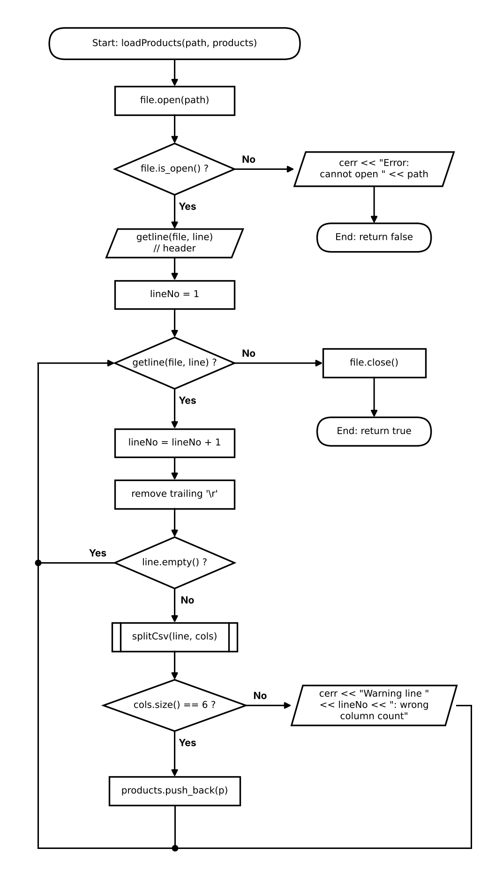
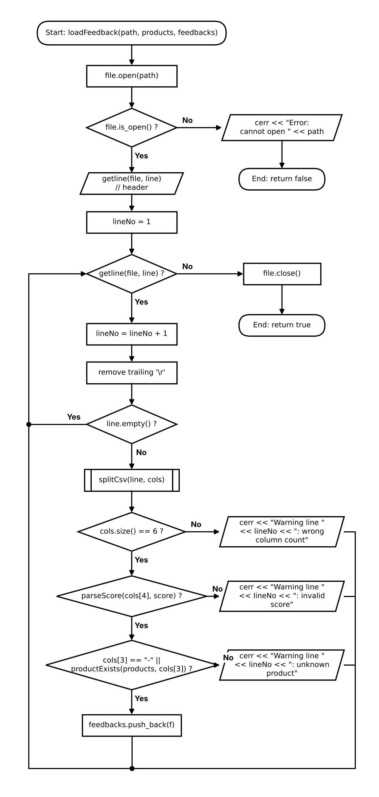

# T03 – loadProducts and loadFeedback

Input: path (CSV file), products (vector<Product>), feedbacks (vector<Feedback>).
Output: true if the file opened, false otherwise. Bad lines are skipped with a warning on cerr.

## loadProducts(path, products)

Pseudocode:

    open file path
    IF file not opened THEN print error; RETURN false
    read header line; lineNo = 1
    WHILE getline(file, line)
        lineNo = lineNo + 1
        remove trailing '\r'
        IF line is empty THEN continue
        splitCsv(line, cols)
        IF cols.size() != 6 THEN warn with lineNo; continue
        add Product to products
    close file
    RETURN true

## loadFeedback(path, products, feedbacks)

Pseudocode: same as loadProducts, with two more checks after the column count:

    IF NOT parseScore(cols[4], score) THEN warn with lineNo; continue
    IF cols[3] != "-" AND NOT productExists(products, cols[3]) THEN warn with lineNo; continue
    add Feedback to feedbacks