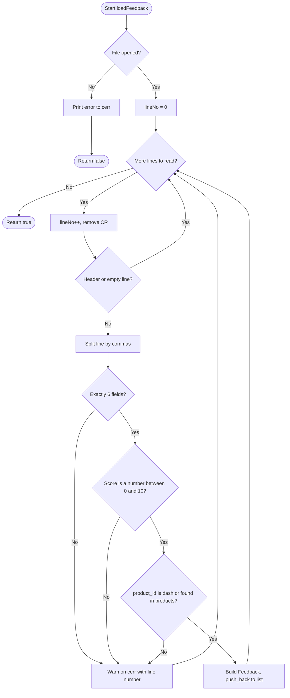

# T03 - loadFeedback 

## Pseudocode
```
FUNCTION loadFeedback(path, products, list) -> bool
    open file at path
    IF file cannot be opened THEN
        print error to cerr; RETURN false
    lineNo <- 0
    WHILE a line can be read:
        lineNo <- lineNo + 1
        remove trailing '\r'
        IF lineNo = 1 OR line is empty THEN skip
        split line by commas into fields
        IF number of fields != 6 THEN warn, skip line
        ELSE IF score is not a number OR score < 0 OR score > 10 THEN
            warn "invalid score" with line number, skip line
        ELSE IF product_id != "-" AND product not found in products THEN
            warn "unknown product" with line number, skip line
        ELSE
            build a Feedback from the fields, add to list
    RETURN true
```

## Flowchart
